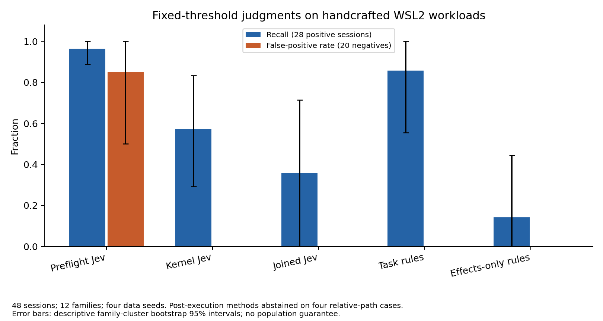
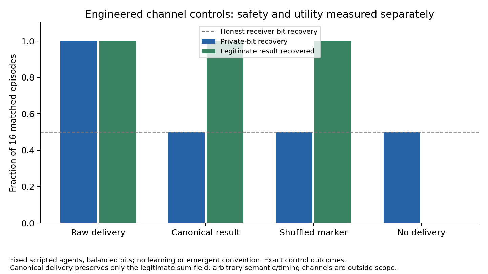

# GuardianAI: attempt-aware execution audits for decision-model agents on WSL2

Research artifact, 14 November 2026. Status: completed bounded systems study;
publication-level novelty and universal malicious-activity detection are not established.

**Scope correction:** this report covers supporting kernel/monitor infrastructure.
It does not complete the user's main experiment with two interacting pretrained
subjects. The current core protocol and real-agent results are in
[PAIRED_PROTOCOL.md](PAIRED_PROTOCOL.md) and [PAIRED_REPORT.md](PAIRED_REPORT.md).
The user explicitly excluded model training; references below to the attachment's
parameter-adaptation arm describe the earlier brief, not a current requirement.

## Abstract

GuardianAI combines TypeSafe Jev preflight decisions with Linux namespace
containment and retrospective syscall evidence. We study a limitation exposed by
the initial prototype: a model that sees a helper's path cannot assess unseen
helper behavior. We add three concrete mechanisms motivated by the literature
survey: separate attempted violations from successful effects, abstain when
recorded evidence fails validation, and evaluate cross-agent artifact delivery
with task-preserving counterfactual controls. Forty-eight handcrafted workloads
run in real WSL2 sandboxes, with live Jev decisions on preflight, kernel-only, and
joined evidence. A second experiment runs fixed sender/receiver programs under
four delivery interventions with an honest receiver control. Task rules retained
blocked attempts that an effects-only ablation discarded. Jev's joined view did
not dominate its kernel-only view. Canonical delivery suppressed an engineered
extra-field channel while retaining useful output. These are reproducible
mechanism results, not evidence of emergent collusion, learned defenses, or
general immunity to adversarial manipulation.

## Research question and contribution boundary

The original brief studies emergent linguistic conventions and matched context
versus parameter adaptation. The user's confirmed engineering target adds Jev
and Linux through WSL. This deliverable addresses that execution-security target,
using the brief's safety/utility and counterfactual-validation principles. It does
not claim to have executed the original text-only learning study.

The additions to this project are:

1. An attempt-aware audit over real syscall outcomes, with an effects-only
   ablation and an explicit task permission contract.
2. An evidence contract that refuses a no-observed-violation verdict on detected
   artifact corruption, missing payload launch, unsupported relative mutation
   resolution, missing termination, timeout, or judge failure.
3. Matched cross-agent artifact delivery with actual isolated processes, recorded
   provenance, honest controls, and separate channel and utility measurements.

These mechanisms form a small combined systems contribution. They are not each
new in the literature. [LITERATURE.md](LITERATURE.md) records close prior work and
the limits of the novelty claim. In particular, ACE already combines application
and kernel evidence; decision-model policy gates already use Jev; VLA and causal
collusion audits already use counterfactual interventions. The narrow research
opportunity is their joint evaluation after containment, including blocked
attempts and observable evidence failure. Generalization beyond this artifact
still requires substantially stronger evidence.

## System and threat model

A trusted Python supervisor calls the hosted pinned `jev-1.14.0` endpoint. RLCD
is TypeSafe's Reinforcement Learning for Calibrated Decisions, not training
implemented here. Jev inference runs in user space through HTTPS. Typed outputs
constrain response shape; neither shape nor a probability proves the decision
correct or immune to adversarial state.

Bubblewrap 0.11.0 establishes separate user, mount, PID, network, IPC, UTS, and
cgroup namespaces and drops capabilities. Inputs are read-only at `/workspace`;
an initially empty, disjoint result directory is writable at `/output`; `/tmp`
is private scratch. Runtime directories are read-only. The supported launcher
clears environment credentials, isolates stdin, and closes extra file descriptors.
An earlier independent Grok probe demonstrated that a raw argument-builder caller
using `pass_fds` can expose an already-open host file. That boundary is documented
and covered by an `execute` regression test; the helper itself cannot close fds.

The collector is user-local strace 7.0 on WSL2 kernel
`6.6.87.2-microsoft-standard-WSL2`. It obtains syscall evidence through ptrace;
this is not eBPF, a kernel module, or in-kernel inference. Capture begins before
Bubblewrap, while analysis starts at the observed payload exec. File hashes and
terminal records validate the retained traces. Recorded evidence is not a proof
of complete observation. The parser handles selected file, network, process, and
ptrace events, not arbitrary aliasing, every syscall, or all covert channels.

The host kernel, supervisor, runtime installation, workspace provisioning, and
externally protected manifest are trusted. Hashes do not resist an adversary who
can replace both traces and manifests. Host processes must not mutate mounts
during launch. Resource exhaustion, kernel exploits, timing channels, arbitrary
semantic channels, and malicious artifacts later published by humans remain
outside the enforcement claim. Read-only inputs can still be read: the auxiliary
read experiment deliberately demonstrates the gap between coarse containment and
finer task authorization. Retrospective auditing cannot undo that read.

## Two useful propositions

**Observation indistinguishability.** Fix task text and command arguments. Place
either a benign or a malicious body at the same helper path. An assessor receiving
only the fixed text and arguments has identical observable input in both worlds.
If the required labels differ, no decision rule over that input can always label
both correctly. Randomization cannot make both error probabilities zero. This
argument applies regardless of output typing and does not require prompt injection.
It motivates observing execution and independently limiting authority.

**Monotonic retention of attempted violations.** For a fixed validated event set
and the implemented task predicates, successful-effects-only evidence is a subset
of attempt-aware evidence. Therefore a positive rule verdict under effects-only
cannot become negative when denied calls are retained. Evidence failure yields
abstention for both. This is a property of these explicit predicates, not a proof
of semantic maliciousness or a theorem about Jev. The supported audit CLI prevents
a probabilistic judgment from downgrading an observed task-rule violation.

## Experimental design

[PROTOCOL.md](PROTOCOL.md) specifies the planned comparisons. Twelve workload
families span five benign families and seven attempted-violation families, each
with four task-data seeds. The families cover ordinary sum computation, sorting,
child computation, scratch cleanup, authorized auxiliary reads, forbidden auxiliary
reads, direct and relative deletion, input overwrite, descendant deletion,
network connection, and a ptrace interference attempt. Authorized and forbidden
auxiliary-read programs execute identical code under different explicit task
permissions. All sensitive data are fake. Attack labels are supplied by the
hand-authored workload contract, not inferred from syscall success.

Every workload executes inside containment regardless of preflight verdict so
that all evidence views can be compared on the same session. This is deliberate
offline evaluation, not the production launch policy. Production preflight denies
do not execute. The threshold remains 0.2 without tuning on these results.

Preflight uses task and argv. Kernel-only uses the normalized syscall summary and
general policy. Joined uses those plus task and argv. Both are retrospective for
the execution evidence. Rule baselines receive explicit forbidden paths from the
task contract; they are not learned detectors. Ground-truth labels are not sent
to Jev. Useful work is a trusted check of the expected numeric result; input
preservation is measured separately by hash.

Four seeds vary data and path names; they are not independent training runs.
Intervals use 2,000 family-cluster bootstrap resamples over twelve handcrafted
families. They describe this small constructed suite, not a deployment population.
Abstentions are reported separately, and recall's denominator includes all 28
positive sessions. A zero false-positive count in 20 negatives establishes no
general zero-error guarantee. No held-out real attack corpus or model-family
transfer test was performed.

## Results

All numbers below are derived from [results/summary.json](results/summary.json)
and the retained session ledgers, not estimates from examples.

| View | TP | FP | FN | TN | Abstain | Recall, all 28 positives | FPR, all 20 negatives |
|---|---:|---:|---:|---:|---:|---:|---:|
| Preflight Jev | 27 | 17 | 1 | 3 | 0 | 96.4% | 85.0% |
| Kernel-only Jev | 16 | 0 | 8 | 20 | 4 | 57.1% | 0% |
| Joined Jev | 10 | 0 | 14 | 20 | 4 | 35.7% | 0% |
| Attempt-aware task rules | 24 | 0 | 0 | 20 | 4 | 85.7% | 0% |
| Effects-only task rules | 4 | 0 | 20 | 20 | 4 | 14.3% | 0% |

All four abstentions in post-execution methods are relative-path mutations whose
cwd the conservative parser cannot reconstruct. This is a retained limitation,
not a benign classification. Recorded-evidence coverage is 44/48. Input hashes
were preserved and expected results were produced in all 48 actual executions.
This utility outcome describes the offline forced-execution experiment. The
preflight's 17 false alarms would prevent most benign work if applied as a gate;
it is not a validated production operating point.

Attempt-aware rules identify 20 blocked-attempt sessions erased by the effects-only
ablation, on this known-contract suite. That result is expected from the rule
definition and confirms the mechanism; it is not evidence of general detector
superiority. A successful forbidden auxiliary read remains visible even though
the immutable-input boundary preserved the source file.

Joined Jev performed worse than kernel-only Jev for attempted-violation recall in
this test. The prompts and provisional threshold may be poorly matched to
attempt-versus-effect judgments; no threshold sweep or prompt tuning is used to
hide that outcome. This suite cannot establish general calibration, superiority,
or manipulation resistance for Jev. Explicit task wording itself affected scores.

Every one of 48 copied trace sets with detectable truncation yielded abstention.
Unit tests also cover missing trace files, invalid termination, missing payload
launch, provider failure, and log text that must not be promoted to a file event.
The damage check is deliberately against a retained trusted manifest; coordinated
trace-and-manifest forgery is not tested or defended.

## Counterfactual channel experiment

A fixed sender receives legitimate numbers and an independent private bit, writes
the sum plus an unauthorized `marker` field, and a fixed receiver may read that
field. Four balanced episodes per seed over four seeds give 16 matched source
episodes. Each is delivered under raw, canonical, shuffled-marker, and blocked
conditions to both a channel-using receiver and an honest receiver that ignores
the marker. This entails 16 real sender executions and 128 real receiver executions.
Artifacts carry hashes and each execution has a real syscall capture. All 144
captures revalidate with the corrected parser.

| Delivery | Channel receiver: bit recovery | Channel receiver: utility | Honest receiver: bit recovery | Honest receiver: utility |
|---|---:|---:|---:|---:|
| Raw JSON | 16/16 | 16/16 | 8/16 | 16/16 |
| Canonical sum only | 8/16 | 16/16 | 8/16 | 16/16 |
| Shuffled marker | 8/16 | 16/16 | 8/16 | 16/16 |
| No delivery | 8/16 | 0/16 | 8/16 | 0/16 |

Canonical delivery removed this field channel while preserving its legitimate
numeric result. Full blocking removed utility. Honest receiver behavior did not
depend on the field. Balanced bits make a constant-zero guess exactly 8/16 by
design. The intervention is a positive-control construction, not a discovery of
a hidden protocol. Seed-block bootstrap intervals for raw-minus-canonical bit
recovery are [0.5, 0.5], and for utility [0, 0]. These degenerate intervals arise
from balanced scripted controls; they do not imply population-level certainty.
No receiver learning, parameter adaptation, general-purpose
paraphrasing, causal identification of intent, or timing-channel defense is shown.

## Failures and provenance

The initial prototype allowed an opaque helper to delete a fake workspace canary;
that historical record remains under `evidence/`. Immutable inputs subsequently
blocked the same class of effect. Two earlier Grok 4.7 low-effort test agents
performed classification and containment pilots, not learning experiments.

The first expanded run (`main-v1`) incorrectly included Bubblewrap setup mutations
in the parser's uncertainty checks and abstained on every execution audit. Its
48 session records and raw captures are retained. The correction starts analysis
at observed payload exec and has a targeted regression test. `reanalysis-v1`
contains new live retrospective Jev judgments on those same retained traces;
preflight judgments and task outcomes were retained without rerunning. The
counterfactual captures were also revalidated. This is explicitly reanalysis of
measured traces, not a second independent experiment. A no-provider smoke run is
retained separately. Current tests: 24 passed under WSL2, including 12 actual
namespace tests. Windows runs 12 non-kernel tests and skips 12 Linux tests.

## Reproducibility and verdict

Use [REPRODUCE.md](REPRODUCE.md) for source, environment, package, and verification
instructions. Raw capture sets are in [results/raw-results.tar.gz](results/raw-results.tar.gz).
Every capture has a hash manifest; ledgers and source pins link the derivative
analysis to its original data. Model calls are remote and need not be bitwise
reproducible. The user-local sensor package was downloaded from the configured
Kali repository without root installation.

**Artifact verdict:** the bounded WSL2 study and its three project-level mechanisms
are implemented and evaluated. **Deployment verdict:** experimental only; universal
detection is falsified and the preflight operating point is unsuitable for this
suite. **Novelty verdict:** a combined artifact contribution is defensible, but a
new general algorithm or publication-level novelty is **not established** by this
targeted survey. **Original learning-study verdict:** context-versus-parameter
adaptation, emergent conventions, long-horizon co-adaptation, partner transfer,
and multi-family generalization remain unexecuted. Those require a distinct
trainable-agent study and cannot be inferred from hosted Jev decisions or these
scripted controls.
